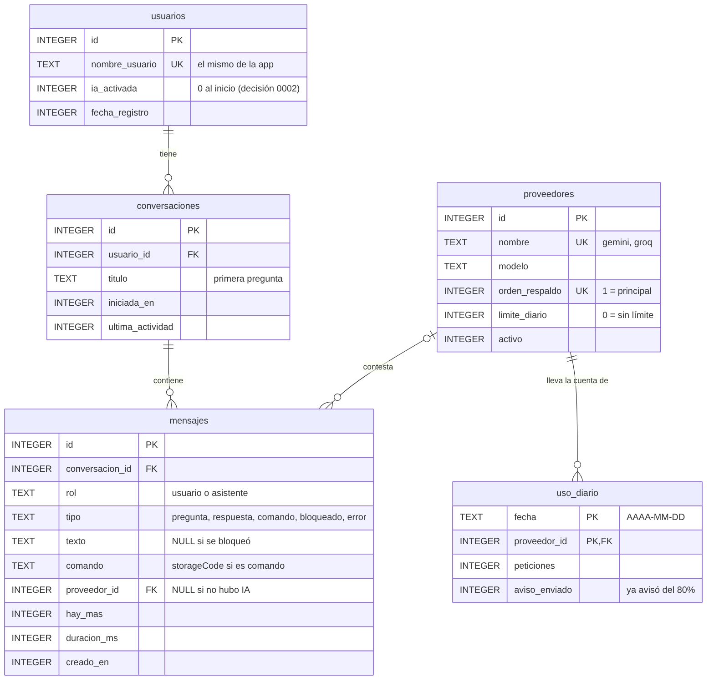
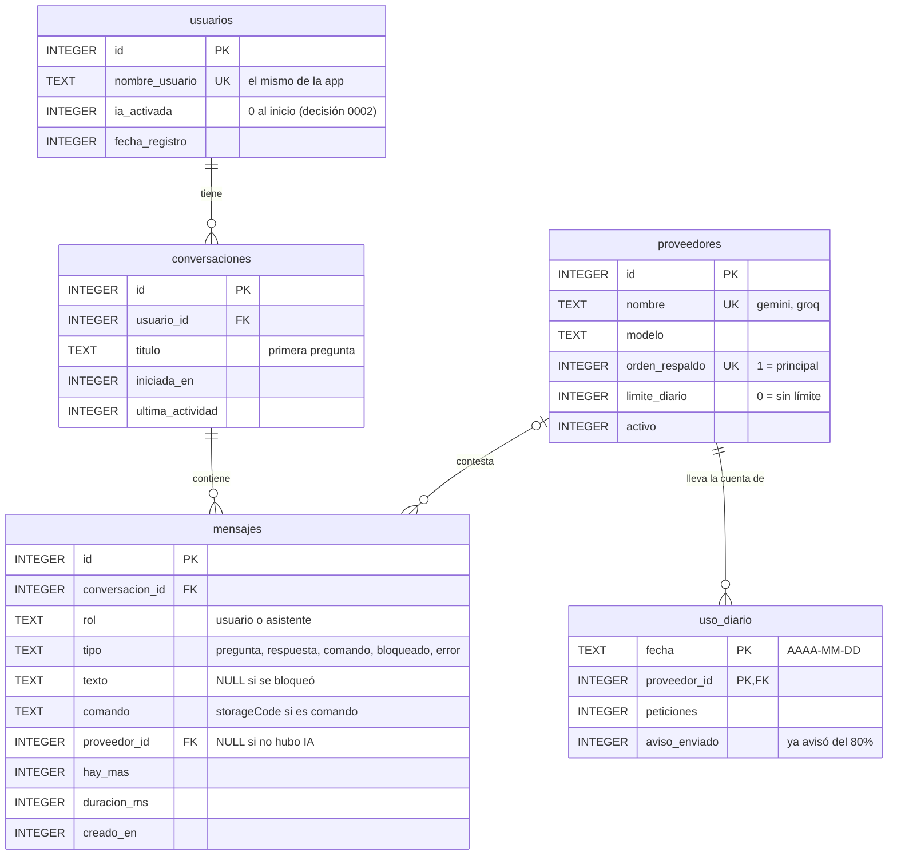

# Tablas del servidor del asistente

> En parte construido · Dueño: Módulo 3 (asistente inteligente) · Revisado el 25 oct 2026 · SQL del diseño: [database/servidor.sql](../../database/servidor.sql) · Código: [backend/bd.py](../../backend/bd.py)

Este es el diseño de las cinco tablas del servidor (`backend/`). **Ya existen tres**: `conversaciones`, `mensajes` y `uso_diario`, en SQLite (`backend/cecapi.db`). `usuarios` y `proveedores` esperan a que el asesor confirme cuáles son las 5 tablas definitivas.

## Lo que ya está construido (25 oct 2026)

Las tablas se crean con migraciones numeradas en `bd.MIGRACIONES` (`PRAGMA user_version`). Para agregar las dos que faltan se escribe la migración 2 al final de la lista; las bases que ya existen se actualizan solas al arrancar, sin perder datos.

Diferencias con el diagrama de abajo, mientras no existan `usuarios` ni `proveedores`:

| Columna del diseño | Cómo quedó | Por qué |
|---|---|---|
| `conversaciones.id` INTEGER | `TEXT`: un UUID al azar | Es el `conversacionId` que ve la app; un número consecutivo dejaría adivinar el de otra persona. |
| `conversaciones.usuario_id` NOT NULL, FK | Sin llave foránea; por ahora siempre NULL | La app todavía no dice quién pregunta. |
| `mensajes.proveedor_id`, `uso_diario.proveedor_id` | `proveedor TEXT` (`groq`, `groq_vision`, `gemini`) | No hay tabla `proveedores`; la migración 2 puede llenar `proveedor_id` a partir del nombre. |
| `mensajes.texto`, `conversaciones.titulo` | NULL mientras `GUARDAR_TEXTOS=0` (por defecto) | [Decisión 0005](../decisiones/0005-responsable-menores-datos-reales.md): no se guardan datos reales hasta que Pp lo autorice. |

Lo demás (roles, tipos, `CHECK`, cascada al borrar e índices) quedó igual. El panel de uso (`GET /panel`) sale de estas tablas y solo muestra números.

No son las tablas del Módulo 3 que están en `database/schema.sql` (`consultas_ia`, `respuestas_ia`, `contextos_conversacion`). Esas viven en el teléfono, con Room. Estas otras viven en la computadora donde corre el servidor.

## Relaciones

| Relación | Tipo | Al borrar |
|---|---|---|
| `usuarios` → `conversaciones` | Una persona tiene cero o muchas conversaciones. | Se borran sus conversaciones. |
| `conversaciones` → `mensajes` | Una conversación tiene cero o muchos mensajes. | Se borran sus mensajes. |
| `proveedores` → `mensajes` | Cada respuesta la dio un proveedor, o ninguno si fue comando, bloqueo o error. | El mensaje se queda, con `proveedor_id` en NULL. |
| `proveedores` → `uso_diario` | Un proveedor tiene una fila por día. La llave es `(fecha, proveedor_id)`. | Se borra su historial de uso. |

Borrar a una persona borra en cascada sus conversaciones y mensajes. Eso hace falta para "borra mi cuenta / borra mis datos".

## De dónde salió cada tabla (antes de la base de datos)

| Tabla | Hoy está en | Notas |
|---|---|---|
| `proveedores` | Clases `Gemini` y `Groq` y la lista `PROVEEDORES` de `backend/proveedores.py`. Límites en `.env`. | Las **claves no** van en la tabla, siguen solo en `.env`. |
| `usuarios` | No existe en el servidor. La app no manda quién pregunta. | Por confirmar con Pp: cómo manda la app el usuario sin mandar la contraseña. |
| `conversaciones` | No existe. La app manda las últimas 6 líneas en `contexto` cada vez. | Con esta tabla, el servidor podría armar el contexto solo. |
| `mensajes` | No se guarda. Las rutas `/preguntar` y `/entender` de `main.py` regresan `respuesta`, `proveedor`, `hayMas`, `tipo` y `comando`. | Si `privacidad.py` bloquea un mensaje, se guarda con `texto` en NULL: el dato sensible nunca se escribe. |
| `uso_diario` | `backend/uso_diario.json` (`fecha`, `conteo`, `avisados`), escrito por `uso.py`. | Misma lógica: avisa al 80% y al 100% salta al respaldo. |

## Pendiente de decidir

- **Cuánto tiempo se guardan los mensajes.** Por confirmar con el equipo de normativa ([borradores de políticas](../agentes/normativa/borradores-politicas.md)).
- **Si la IA se queda desactivada** para menores ([decisión 0005](../decisiones/0005-responsable-menores-datos-reales.md)). Afecta a `usuarios.ia_activada`.

Para regenerar la imagen: `mmdc -i diagrama.mmd -o docs/referencia/tablas-servidor.png -b white`, con el bloque `mermaid` de arriba guardado como `diagrama.mmd`.
